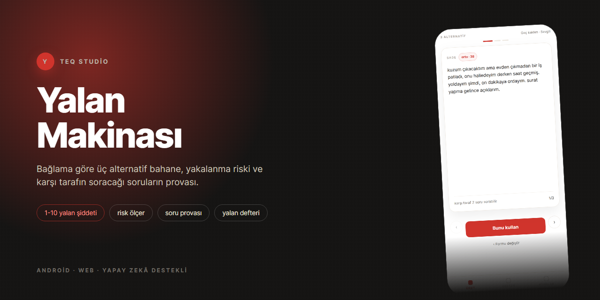
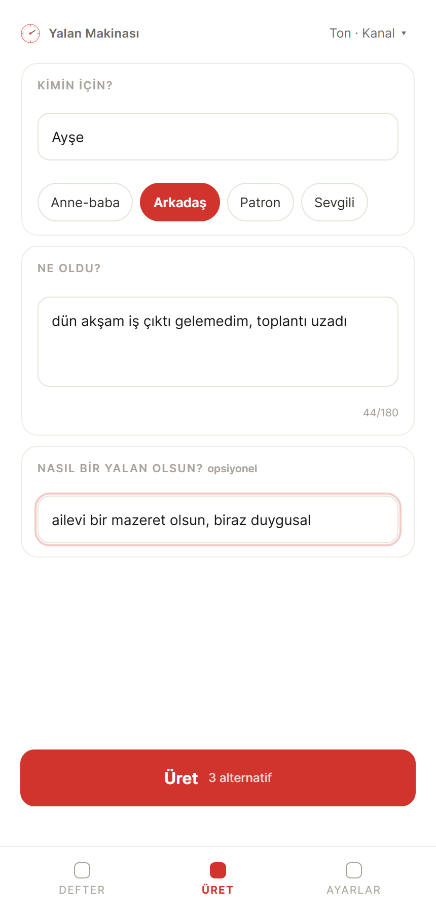
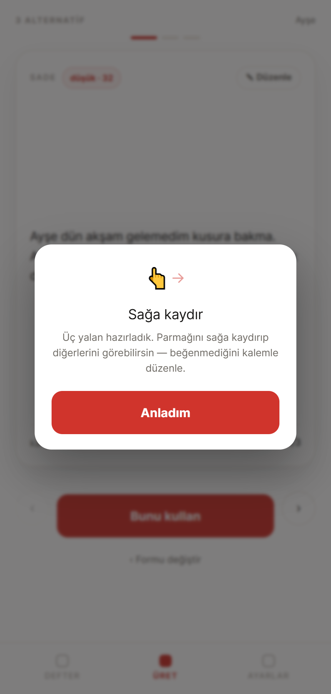
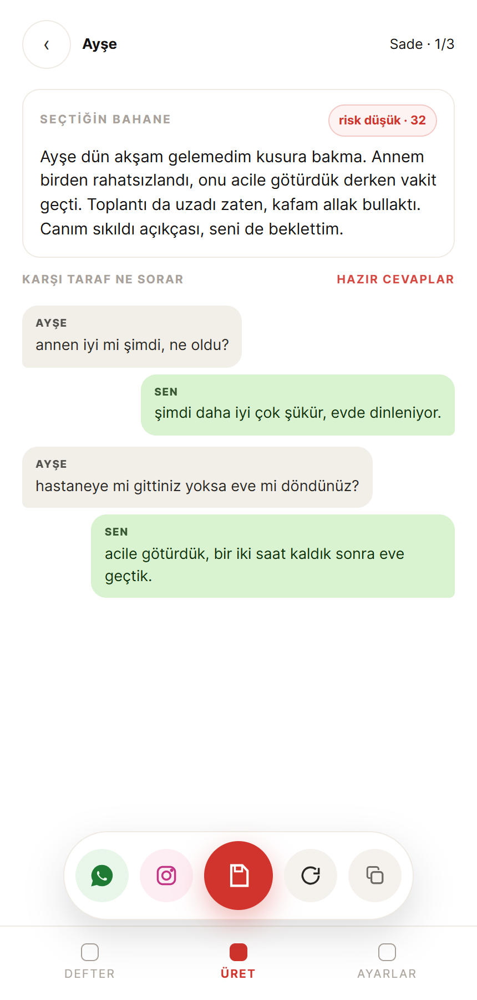
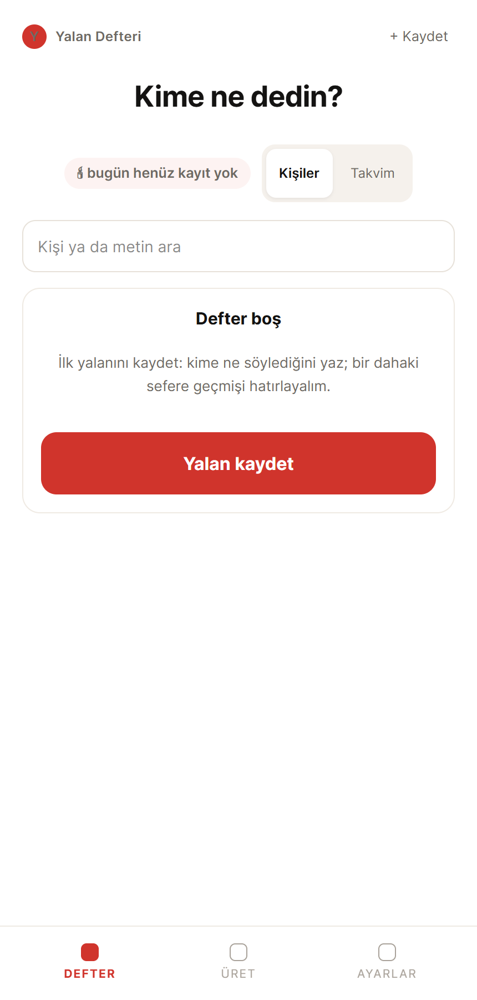
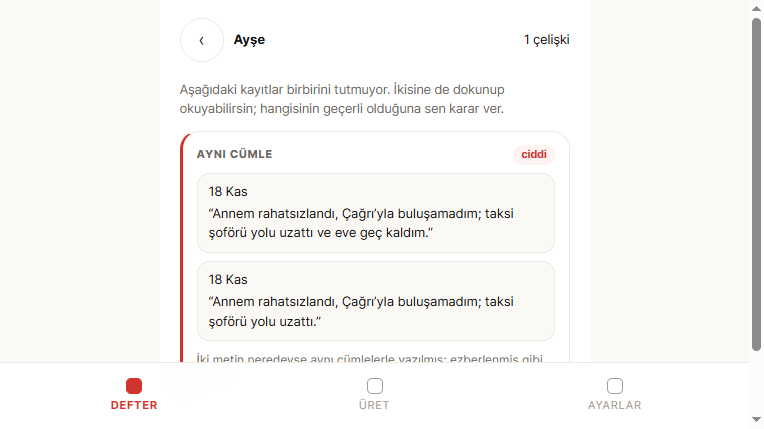
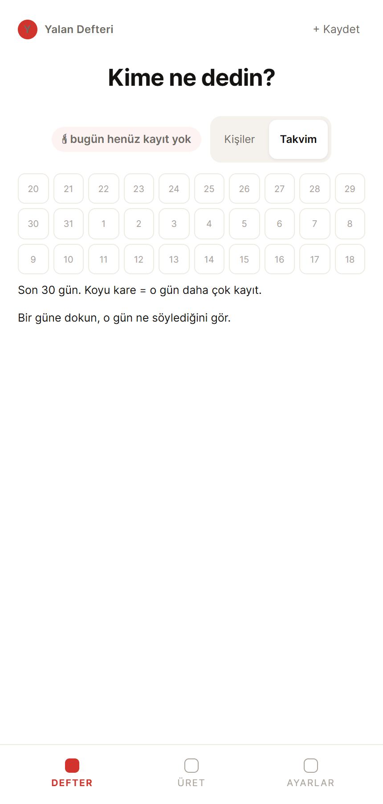
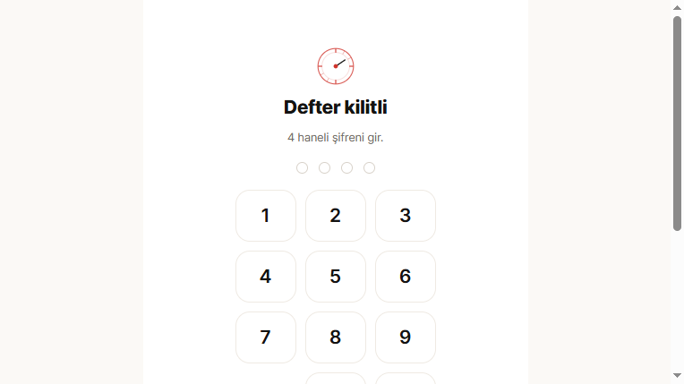
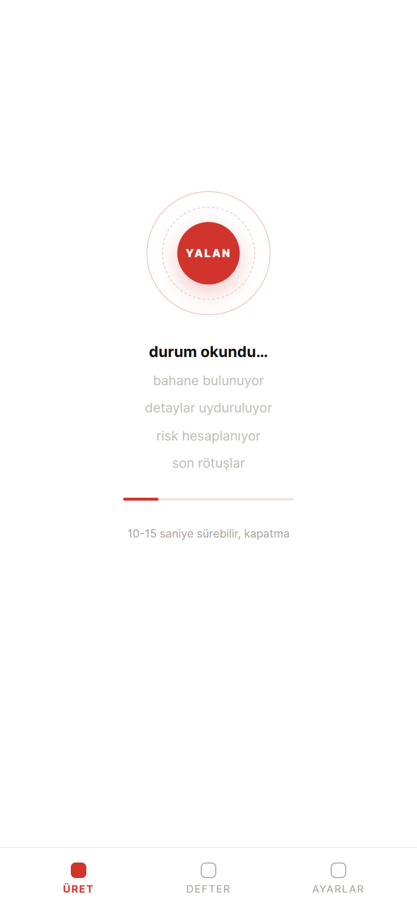

<p align="center">
  
</p>

<h1 align="center">Yalan Makinası</h1>

<p align="center">
  Yalan defterin: kime ne dedin, tuttu mu? Gerektiğinde üç alternatif bahane, riski ve hazır cevaplar.
</p>

<p align="center">
  <a href="LICENSE"></a>
  
  
  
  
  
  
  <a href="https://alhndgn.github.io/yalan-makinasi/"></a>
</p>

## Neden Yalan Makinası?

- **Önce defter, sonra üretim.** Kime ne söylediğini kaydet (kendin yaz ya da üret); uygulama kişiye göre gruplar, arama yapar, çelişkileri işaretler.
- **"Ne diyeyim?"** Karşı taraf bir soru sorduğunda kaydın altına yazarsın, söylediğin yalanla çelişmeyen cevabı hazırlar.
- **Geçmişi hatırlayan yapay zekâ.** Yeni bahane üretirken aynı kişiye son 5 kaydı okur: aynı bahaneyi tekrar etmez, ayrıntıları (yer/saat/tanık) çelişmez.
- **Şablon değil, bağlam.** Kime, hangi durumda, hangi kanalda söylediğini bilir; kişi profilindeki samimiyet ve hitap bilgisiyle yazar.
- **Çelişki ekranı.** Aynı kişiye söylediğin iki kayıt birbirini tutmuyorsa (aynı mazeret, aynı cümle, aynı gün iki farklı bahane, zıt ayrıntı) yan yana gösterir ve nedenini yazar.
- **Karnesi ve takvimi var.** Kişi bazında tutma oranı, en sık kullanılan bahane; son 30 günün ısı haritası.
- **Risk ölçer.** Her metnin yakalanma riski 0-100 arasında puanlanır ve nedenleri yazılır.
- **Soru provası.** Karşı tarafın soracağı en olası 3 soru ve **metinle çelişmeyen** cevapları hazırlanır.
- **Yalan Defteri.** Ne dediğini, tutup tutmadığını kaydeder; 48 saat sonra "tuttu mu?" diye sorar.
- **Kilit.** 4 haneli şifre (cihazda PBKDF2 ile saklanır, düz metin yok) — defteri eline alan açamaz.
- **İki dilli.** İlk açılışta bir kez dil sorulur; arayüz ve yapay zekâ çıktısı Türkçe ya da İngilizce.
- **İnsan gibi yazar.** Prompt, "Kesinlikle / Ayrıca / umarım" gibi makine kalıplarını yasaklar; günlük konuşma diline kalibre edilmiştir.

## Ekranlar

<table>
  <tr>
    <td width="50%"></td>
    <td width="50%"></td>
  </tr>
  <tr>
    <td align="center"><b>Tek ekran:</b> kime, ne oldu, nasıl bir yalan</td>
    <td align="center"><b>Deste:</b> üç alternatif, kaydırarak gez</td>
  </tr>
  <tr>
    <td width="50%"></td>
    <td width="50%"></td>
  </tr>
  <tr>
    <td align="center"><b>Tam ekran:</b> WhatsApp gibi soru-cevap, kaydet</td>
    <td align="center"><b>Karne:</b> tutma oranı, en sık bahane</td>
  </tr>
</table>

<table>
  <tr>
    <td width="50%"></td>
    <td width="50%"></td>
  </tr>
  <tr>
    <td align="center"><b>Çelişkiler:</b> iki kayıt yan yana, nedeni yazılı</td>
    <td align="center"><b>Takvim:</b> son 30 gün</td>
  </tr>
  <tr>
    <td width="50%"></td>
    <td width="50%"></td>
  </tr>
  <tr>
    <td align="center"><b>Kilit:</b> 4 haneli şifre</td>
    <td align="center"><b>Üretim:</b> durum değerlendiriliyor…</td>
  </tr>
</table>

## Özellikler

| | |
|---|---|
| **Dil** | Türkçe + English: ilk açılışta bir kez sorulur, Ayarlar'dan değişir, yapay zekâ da o dilde yazar |
| **Üretim** | 5 hedef × 7 durum, 3 strateji (sade / detaylı / duygusal), sabit doz |
| **Analiz** | risk puanı + nedenleri, karşı tarafın soruları ve çelişmeyen cevaplar |
| **Defter** | kişiye göre gruplu kayıtlar, arama, `beklemede → tuttu / tutmadı`, çelişki işareti |
| **Ne diyeyim?** | kayıtlı yalanın ardından gelen soruya çelişmeyen cevap (AI + şablon yedeği) |
| **Çelişki** | aynı mazeret / aynı cümle / aynı gün iki bahane / zıt ayrıntı — deterministik motor (`src/engine/conflict.ts`) |
| **Karne + takvim** | tutma oranı, en sık bahane, son 30 gün ısı haritası |
| **Hatırlatma** | 48 saat beklemede kalan kayıt için yerel bildirim (web'de bant) |
| **Kilit** | 4 haneli PIN, PBKDF2 + salt, 5 yanlışta bekleme, "unuttum" → destek |
| **Manuel kayıt** | kendi yalanını yaz: kişi, metin, durum, kanal |
| **Paylaşım** | panoya kopyala, WhatsApp'a at, 1080×1350 paylaşım kartı indir |
| **Motor** | AI öncelikli; yapay zekâya ulaşılamazsa cihaz içi deterministik şablon motoru |
| **Platform** | Android (Capacitor) + web/PWA, veriler cihazda ya da kendi sunucunda |
| **Gizlilik** | hesap yok, çerez yok, analitik yok, reklam yok — [TR](https://alhndgn.github.io/yalan-makinasi/) · [EN](https://alhndgn.github.io/yalan-makinasi/en.html) |

## Hızlı başlangıç

```bash
npm install
npm run build     # arayüzü derler → src/web/dist
npm start         # http://127.0.0.1:8787 (API + arayüz tek süreç)
```

Geliştirme: `npm run dev:api` (8787) + `npm run dev:web` (5173, proxy'li).

### Yapay zekâ (isteğe bağlı)

Uygulama AI olmadan da çalışır (şablon motoru). AI istiyorsan `.env.local` oluştur:

```bash
VITE_AI_BASE_URL=https://opencode.ai/zen/go/v1
VITE_AI_MODEL=deepseek-v4.1-flash
VITE_AI_KEY=anahtarin             # APK'da gömülü kullanılır
AI_KEY=anahtarin                  # web proxy'si için
```

> `.env.local` git'e girmez. Anahtar **asla** repoya commit edilmemelidir.

### Android

```bash
bash scripts/build-apk.sh                  # VITE_LOCAL_ENGINE=1 + cap sync + gradle assembleDebug
adb install -r android/app/build/outputs/apk/debug/app-debug.apk
```

## Mimari

```
src/
  engine/          saf TypeScript motor (tarayıcıda da çalışır)
    templates/tr/  7 durum bankası, detay nesnesi {tag,text,q,a}
    compose.ts     deterministik PRNG ile birleştirme
    risk.ts        0-100 risk formülü (eşik 35/65)
    queries.ts     metindeki detaylardan soru üretimi
    prompt.ts      şiddet bantlı AI sistem promptu
    providers/     template | openaiCompat
  server/          Fastify 5 + node:sqlite, /api rotaları, AI proxy
  web/             React 19 + Vite, üç adımlı akış, deste, defter
  shared/          zod şemaları (iki taraf ortak)
android/           Capacitor projesi (com.teqstudio.yalan)
```

**İki veri modu:** `server` (SQLite + `/api`) ve `local` (`VITE_LOCAL_ENGINE=1` → cihaz içi motor + `localStorage`). İkisi ayrı veri tutar; senkron yoktur.

## Test

```bash
npm test          # 115 test: motor, API, AI istemcisi, arayüz akışı
```

## Ortam değişkenleri

| Değişken | Varsayılan | Açıklama |
|---|---|---|
| `PORT` | `8787` | Sunucu portu |
| `DB_PATH` | `data/yalan.db` | SQLite dosyası |
| `AI_MODE` | `off` | Sunucu tarafı motor: `off` / `ollama` / `openrouter` |
| `AI_BASE_URL`, `AI_KEY`, `AI_MODEL` | — | Web için AI proxy'si |
| `VITE_AI_BASE_URL`, `VITE_AI_KEY`, `VITE_AI_MODEL` | — | Derleme zamanında gömülen istemci AI ayarı |
| `RATE_LIMIT_PER_MIN` | `20` | Üretim isteği sınırı |

## Yol haritası

- [x] Üretici + risk + soru provası
- [x] Yalan Defteri + çelişki uyarısı
- [x] Paylaşım kartı, splash, üç adımlı akış
- [x] AI beyni (deepseek-v4.1-flash), deste + tam ekran akışı
- [x] Yalan defteri odaklı yeniden kurgu: kişi bazlı kayıtlar, "ne diyeyim", geçmişi hatırlayan AI
- [x] Tek ekran form, sabit doz, kişi profili (hitap + sen/siz)
- [x] İki dilli arayüz (TR/EN) — dil seçimi ilk açılışta, AI de o dilde yazıyor
- [x] Çelişki ekranı, kişi karnesi, takvim, akıbet hatırlatması, 4 haneli defter kilidi
- [ ] Ana ekran widget'ı (native)
- [ ] Topluluk akışı (oy, yorum)
- [ ] Play Store yayını (AI anahtarının sunucuya taşınmasından sonra)

## Lisans

MIT — bkz. [LICENSE](LICENSE). Uygulama eğlence amaçlıdır; resmî belge, sağlık raporu veya hukuki içerik üretmez.

<p align="center"><sub>Developed by <b>Teq Studio</b> · teqstudio@hotmail.com</sub></p>
